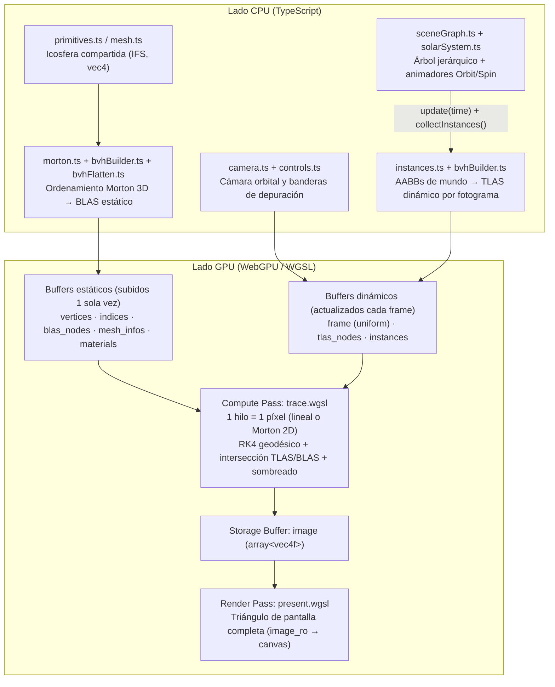

# Arquitectura del Simulador de Lentes Gravitacionales (WebGPU)

Este documento describe la arquitectura general del motor de trazado de rayos relativista en tiempo real, la separación de responsabilidades entre CPU y GPU y las decisiones de diseño tomadas en esta versión inicial.

---

## 1. Visión general del flujo CPU → GPU

---

## 2. Responsabilidad de cada módulo

| Carpeta / Archivo | Rol en la arquitectura |
|---|---|
| `src/main.ts` | Punto de entrada: inicializa WebGPU, crea la escena, sube la geometría estática una vez y ejecuta el bucle por fotograma (`update` → `updateDynamicBuffers` → compute pass → render pass). |
| `src/gpu/device.ts` | Solicita `GPUAdapter` y `GPUDevice`, verifica `maxStorageBuffersPerShaderStage` (≥ 7) y `maxStorageBufferBindingSize`, y configura el `GPUCanvasContext`. |
| `src/gpu/layouts.ts` | Fuente única de verdad con los tamaños y offsets en bytes de los 7 structs compartidos con WGSL (`FrameUniforms`, `PresentUniforms`, `Material`, `Vertex`, `BvhNode`, `Instance`, `MeshInfo`). Validada automáticamente por `tests/bvh.test.ts`. |
| `src/gpu/buffers.ts` | Separa los buffers **estáticos** (mallas, BLAS, materiales) de los **dinámicos** (uniforms, instancias, TLAS). |
| `src/gpu/pipelines.ts` | Compila los shaders concatenados, reporta mensajes de `getCompilationInfo()` con archivo y línea original y construye los pipelines de cómputo y presentación con `minBindingSize` explícito. |
| `src/geometry/mesh.ts` | Estructura **Indexed Face Set** (`Float32Array` de vértices rellenados a `vec4` y `Uint32Array` de índices contiguos). |
| `src/geometry/primitives.ts` | Generador de **icosfera** de subdivisión configurable (`20 · 4^s` triángulos; por defecto `s = 4` → 5 120 triángulos). |
| `src/geometry/objLoader.ts` | Stub documentado (`TODO(ext)`) para futura carga de mallas `.obj` (naves y asteroides). |
| `src/scene/sceneGraph.ts` | Grafo de escena jerárquico con soporte de instanciación (DAG de mallas) y animadores extensibles (`Orbit`, `Spin`). |
| `src/scene/instances.ts` | Empaquetado binario de instancias (`worldFromLocal`, `localFromWorld`, `meshId`, `materialId`), cálculo de AABBs de mundo por el método de Arvo y tabla de materiales. |
| `src/scene/camera.ts` | Cámara orbital en coordenadas esféricas alrededor del origen. |
| `src/scene/solarSystem.ts` | Escena inicial a gran escala (`escapeRadius = 600 rs`): 1 agujero negro principal (`rs = 1`), 1 agujero negro secundario opcional (`rs = 0.45`), 1 estrella emisiva, 6 planetas y 3 lunas compartiendo una única malla en GPU. |
| `src/accel/morton.ts` | Codificación y decodificación de códigos de Morton (orden Z) en **2D** (16 bits por eje) y **3D** (10 bits por eje → 30 bits). |
| `src/accel/bvhBuilder.ts` | Construcción del **BLAS** (estático por malla) y del **TLAS** (dinámico por escena) ordenando primitivas por código de Morton 3D y particionando por el bit más significativo diferente (estilo LBVH). |
| `src/accel/bvhFlatten.ts` | Aplanado en pre-orden (depth-first) a nodos de 32 bytes y recorrido de referencia en CPU con pila explícita para pruebas unitarias. |
| `src/shaders/*.wgsl` | Módulos del shader de cómputo (`common`, `geodesic`, `intersect`, `shading`, `trace`) y de presentación (`present`), ensamblados en `src/shaders/index.ts`. |
| `src/ui/controls.ts` y `stats.ts` | Controles de ratón/teclado y panel de telemetría en tiempo real (FPS, ms/frame, conteo de instancias, triángulos y nodos BVH). |

---

## 3. Presupuesto de buffers en GPU (restricción de 8 storage buffers)

El estándar WebGPU garantiza un mínimo de **8 storage buffers por etapa de shader** (`maxStorageBuffersPerShaderStage = 8`). Para mantenernos dentro del límite garantizado en cualquier GPU:

- **Uniform buffers (2):**
  - `@binding(0) frame: FrameUniforms` (224 B): incluye cámara, luz, parámetros RK4 y el arreglo `black_holes: array<vec4f, 4>`.
  - `@binding(1) materials: array<Material, 64>` (3 072 B): tabla de materiales en memoria uniforme.
- **Storage buffers en la etapa `COMPUTE` (7 ≤ 8):**
  - `@binding(2) image` (`read_write`, `array<vec4f>`)
  - `@binding(3) vertices` (`read`, `array<Vertex>`)
  - `@binding(4) indices` (`read`, `array<u32>`)
  - `@binding(5) blas_nodes` (`read`, `array<BvhNode>`)
  - `@binding(6) mesh_infos` (`read`, `array<MeshInfo>`)
  - `@binding(7) tlas_nodes` (`read`, `array<BvhNode>`)
  - `@binding(8) instances` (`read`, `array<Instance>`)
- **Storage buffers en la etapa `FRAGMENT` (1, solo lectura):**
  - `@binding(1) image_ro` (`read`, `array<vec4f>`)

---

## 4. Decisiones de diseño destacables

1. **Separación pivote / cuerpo en el grafo de escena:** cada planeta o luna se representa con un nodo *pivote* (que tiene el animador `Orbit`) y un nodo hijo *cuerpo* (que tiene la escala del radio, el `Spin` y el `meshId`). Las lunas cuelgan del *pivote* del planeta para heredar únicamente su traslación orbital y no su escala ni su rotación diaria.
2. **Invariancia afín del parámetro $t$ del micro-segmento:** al transformar el micro-segmento $P(t) = p_0 + t\cdot d$ ($t \in [0, 1]$) al espacio local de una instancia con `localFromWorld` **sin normalizar $d$**, el valor de $t$ en espacio local coincide exactamente con el de espacio de mundo. Esto evita transformar cada punto de impacto de vuelta para comparar distancias.
3. **Bloques 8×8 en orden Z para el modo Morton de imagen:** el compute shader se despacha en grupos 1D de 64 hilos (`@workgroup_size(64, 1, 1)`). Cuando `FLAG_MORTON` está activo, los 64 hilos de un workgroup recorren un bloque 8×8 de píxeles siguiendo `decode_morton_2d(0..63)` y escriben en índices Morton consecutivos del buffer `image`.

